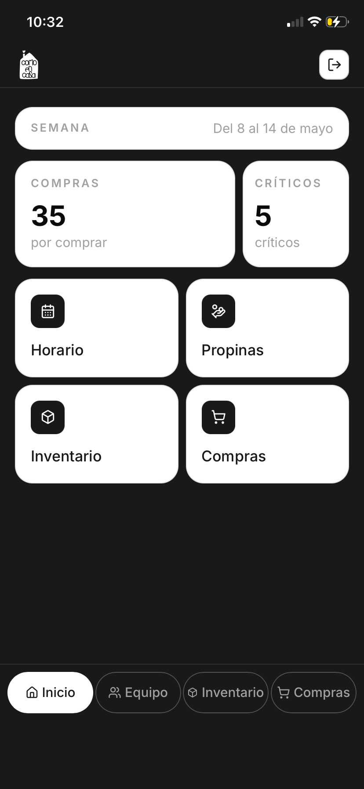
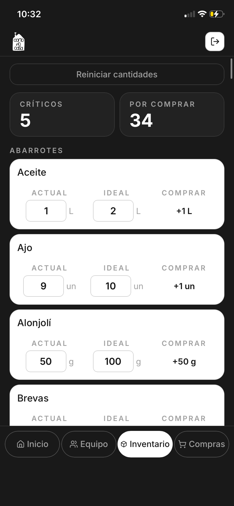
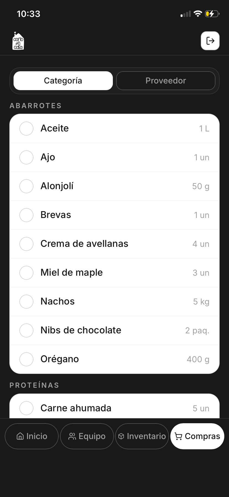
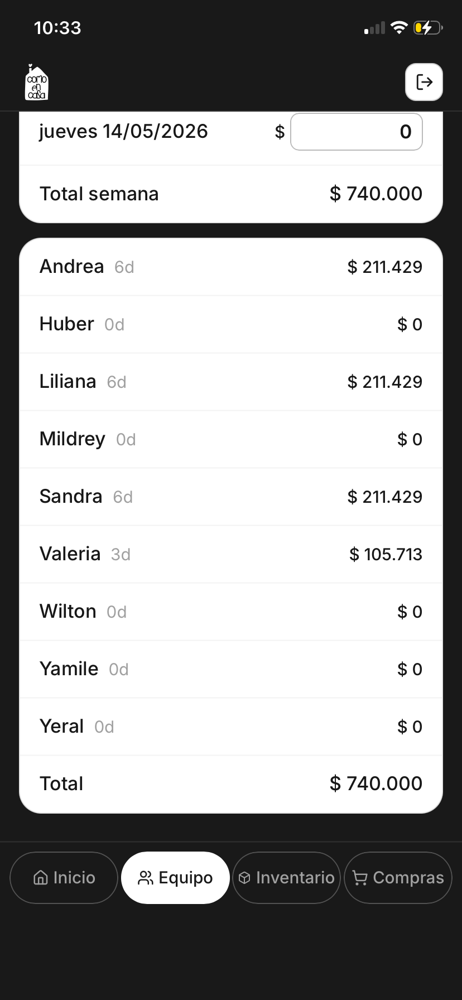
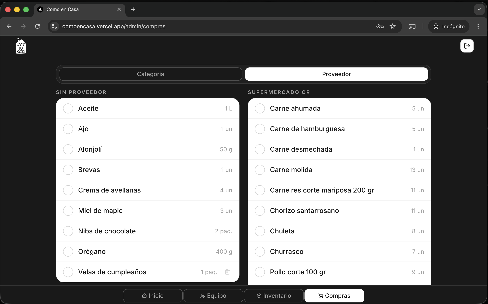

# Como en Casa Admin

An internal operations dashboard for a small food business. Como en Casa Admin replaces notebooks, WhatsApp threads, paper tip calculations, and manual inventory checks with a single role-aware tool for daily café/restaurant operations. Built end to end as a solo project — from product scope and data modeling to mobile-first UI, Supabase persistence, role permissions, PWA setup, and deployment.

> Demo access: This project is connected to a real internal workflow, so production business data is not public. Screenshots and a portfolio case study can be used to show the product without exposing private operational data.

---

## The Problem

Small food businesses often run critical operations through scattered, manual workflows: inventory counts in notebooks, purchase needs calculated by eye, employee schedules shared through chat, and tips split on paper.

For Como en Casa, that meant the team could operate day to day, but the process was fragile: easy to forget, hard to audit, and difficult to keep consistent across kitchen, service, and pastry roles.

Como en Casa Admin turns those recurring tasks into a structured internal system designed around the way the team actually works.

---

## What It Does

### Inventory and purchase planning

Tracks products by current stock, ideal stock, category, supplier, and unit. The app calculates what needs to be purchased from the difference between current and ideal stock.

```txt
ideal stock - current stock = quantity to buy
```

Admins can manage product names and inventory structure. Team users can update current and ideal stock values from their phones.

### Purchases

Combines auto-generated inventory needs with manually added purchase items. Items can be grouped by category or supplier, helping the team quickly understand what needs to be restocked.

### Team management

Stores employee information, roles, contact details, and active/inactive status. Employee data is shared across scheduling and tip distribution.

### Work schedule

Weekly grid for tracking worked days by employee. Admins can toggle work days, navigate between weeks, and persist schedule data in Supabase.

### Tip distribution

Admins enter daily tip totals. The app distributes tips proportionally based on the number of days worked during the week, using persisted schedule and tip data.

### Role-based access

Admin users can manage the full system. Employee users can view the main sections and update inventory quantities, but cannot mutate purchases, employees, schedules, or tips.

| Permission | `admin` | `employee` / `equipo` | `demo` |
|---|---:|---:|---:|
| View dashboard | ✅ | ✅ | ✅ |
| View inventory | ✅ | ✅ | ✅ |
| Edit current stock | ✅ | ✅ | ❌ |
| Edit ideal stock | ✅ | ✅ | ❌ |
| Edit product names | ✅ | ❌ | ❌ |
| View purchases | ✅ | ✅ | ✅ |
| Manage purchases | ✅ | ❌ | ❌ |
| View team | ✅ | ✅ | ✅ |
| Manage employees | ✅ | ❌ | ❌ |
| View schedule | ✅ | ✅ | ✅ |
| Edit schedule | ✅ | ❌ | ❌ |
| View tips | ✅ | ✅ | ✅ |
| Edit tip amounts | ✅ | ❌ | ❌ |

A **"Ver demo"** button on the login screen allows recruiters to explore the app without credentials. Demo users have the `demo` role — view-only access across all sections, no writes.

---

## Technical Highlights

### Stack

| Layer | Technology | Why |
|---|---|---|
| Framework | Next.js 16 App Router | Server-rendered admin pages, protected routes, and fast deployment through Vercel. |
| Frontend | React, TypeScript, Tailwind CSS v4 | Typed UI logic, responsive layouts, and fast iteration on internal tool screens. |
| Backend | Supabase: Postgres, Auth, RLS | Managed database, authentication, and database-level access control. |
| Persistence | PostgreSQL tables per domain | Inventory, employees, purchases, schedule, tips, and profiles are modeled separately. |
| PWA | Web App Manifest + Apple mobile metadata | App-like install experience for staff phones. |
| Hosting | Vercel | Automatic deployment from `main`. |

### Architecture

```txt
src/
├── app/
│   ├── admin/
│   │   ├── compras/           # Purchase planning
│   │   ├── gestion-equipo/    # Employees, schedule, and tips
│   │   ├── inventario/        # Inventory management
│   │   └── page.tsx           # Dashboard
│   ├── empleado/              # Legacy employee routes / redirects
│   └── login/                 # Authentication
├── components/
│   └── admin/                 # Admin shell, employee shell, mobile navigation
└── lib/
    ├── permissions.ts         # Role → permissions map
    ├── mock-data.ts           # Types, helpers, demo fallback data
    └── supabase/              # Supabase clients and domain data modules
        ├── auth.ts
        ├── browser.ts
        ├── employees.ts
        ├── employee-writes.ts
        ├── inventory.ts
        ├── schedule.ts
        ├── tips.ts
        └── tip-actions.ts
```

Pattern: Server-rendered pages load authenticated data from Supabase and pass it into client components. Client components handle interaction-heavy flows like inventory edits, schedule toggles, and tip inputs. Domain data access lives in `src/lib/supabase`, while role permissions are centralized in `src/lib/permissions.ts`.

---

## Key Technical Decisions

### Supabase as the source of truth

Inventory, employees, manual shopping items, work schedules, tip weeks, daily tip amounts, and payment status are persisted in Postgres. Mock data is kept only as a fallback/demo layer, not as the production source of truth.

### Role permissions in one place

Permissions are derived from the user's `profiles.role` value and mapped through `src/lib/permissions.ts`. UI controls are hidden or disabled based on permissions, and mutation handlers also guard restricted actions.

### RLS-backed access model

Supabase Row Level Security protects reads and writes at the database level. The UI permission layer improves user experience, but database policies remain the final boundary.

### Server Actions for RLS-sensitive writes

Schedule and tip writes use Server Actions so Supabase can resolve `auth.uid()` from the server-side session context. This avoids silent client-side RLS failures for authenticated mutations.

### Inventory-driven purchase logic

Purchase needs are derived from inventory state instead of entered manually every time. The app calculates buy quantities from `ideal_stock - current_stock`, keeping restock decisions tied to the inventory source of truth.

### Mobile-first shell

The interface is designed for staff phones first. The shell uses an internal scroll container and in-flow bottom navigation to avoid iOS Safari/PWA viewport jumps and keep navigation stable across routes.

---

## Data Model

Main tables:

| Table | Purpose |
|---|---|
| `profiles` | User role and auth-linked profile |
| `employees` | Team members and employee details |
| `inventory` | Product stock, category, supplier, and ideal quantity |
| `manual_shopping_items` | Manually added purchase items |
| `tip_weeks` | Weekly tip periods |
| `tip_daily_amounts` | Daily tip totals per week |
| `work_schedule` | Worked days per employee |
| `tip_payments` | Tip payment status per employee/week |

---

## Mobile and Desktop UX

Como en Casa Admin is built as a mobile-first PWA because the staff workflow happens mostly from phones.

Mobile work includes:

- Installable PWA configuration.
- Web App Manifest and Apple mobile metadata.
- Safe-area support for iPhone.
- Stable bottom navigation across short and long pages.
- Compact inventory cards with editable quantity inputs.

Desktop work includes:

- Wider admin layouts.
- Two-column category layouts for inventory and purchases.
- Larger schedule and tip management views.

---

## Local Setup

Requires Node.js 20+ and a Supabase project.

```bash
npm install
cp .env.example .env.local
npm run dev
```

Environment variables:

```env
NEXT_PUBLIC_SUPABASE_URL=
NEXT_PUBLIC_SUPABASE_ANON_KEY=

# Optional: enables the "Ver demo" button on the login screen
NEXT_PUBLIC_DEMO_EMAIL=
NEXT_PUBLIC_DEMO_PASSWORD=
```

Open:

```txt
http://localhost:3000
```

---

## Commands

```bash
npm run dev       # Local development server with Turbopack
npm run build     # Production build
npm run start     # Run production build
npm run lint      # ESLint, if configured
```

---

## Project Status

Core product flows are implemented:

- Authenticated admin and employee access.
- Inventory persistence.
- Purchase planning.
- Employee management.
- Weekly schedule tracking.
- Tip distribution.
- Mobile PWA setup.
- Desktop responsive layouts.

Current follow-up items:

- Tighten RLS policies further per role.
- Add a write path for marking tip payments as paid.
- Replace demo fallback staff names before making the repo fully public.
- Add final screenshots to the README and portfolio case study.

---

## Screenshots

### Mobile

| Dashboard | Inventory |
|---|---|
|  |  |

| Purchases | Tips |
|---|---|
|  |  |

### Desktop

| Purchases |
|---|
|  |

---

## Case Study Notes

This project is strongest as a portfolio case study because it shows a real workflow turned into software:

- Translating restaurant operations into a data model.
- Building role-aware internal tools.
- Debugging Supabase RLS and persistence issues.
- Solving iOS PWA layout problems.
- Designing for non-technical users on mobile devices.
- Keeping desktop useful for admin work.

---

## License

Private/internal project.